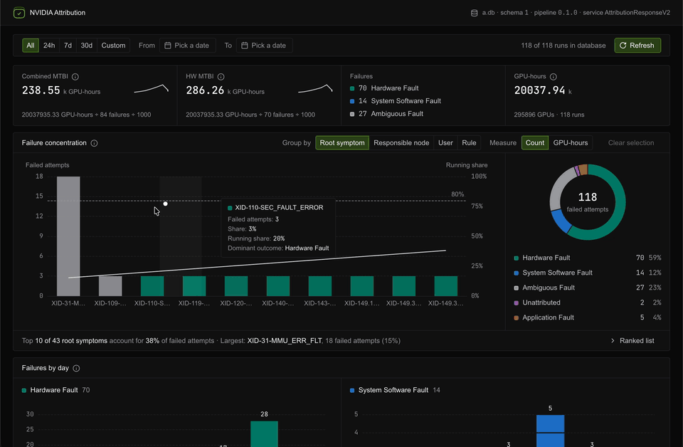

# NVIDIA Attribution

**Open source · pre-1.0**

NVIDIA Attribution is a service-plus-orchestrator that turns the raw symptoms of a failed GPU workload into one structured diagnosis with the symptom chain that produced it.

Modern AI training and inference workloads fail in dozens of ways. A multi-rank workload at 10k-GPU scale typically produces hundreds to tens of thousands of log lines across application logs, host syslogs, scheduler database entries, GPU driver dmesg, fabric manager logs, and metric backends. Application logs in particular scale with rank count, so volume grows with the size of the workload. Triaging them by hand breaks down at production-cluster volume. NVIDIA Attribution automates the cross-correlation. Each failed workload becomes one structured diagnosis, with the cascade rendered as the symptom chain that produced it.

**Status.** NVIDIA Attribution is open-source software. The Service exposes a versioned HTTP API. The Library and Blueprint interfaces can change. See [SUPPORT.md](SUPPORT.md#interface-compatibility) for compatibility commitments and [CONTRIBUTING.md](CONTRIBUTING.md) to propose improvements.

<p align="center">
  
</p>

## Two deployable forms

NVIDIA Attribution ships in two components that share one rules engine. Pick the form that matches how you want to integrate.

* **Attribution Blueprint.** A Python reference orchestrator that discovers workloads from your scheduler, collects log and metric evidence from your telemetry stack, calls the Attribution Service, and persists the diagnosis. The Blueprint owns the connector contracts (scheduler, logs, metrics, output) and is the fastest path to a running system. Use when you want a working deployment fast, for a proof-of-concept or as the starting point for your own production topology. Ships with a read-side dashboard that renders the per-workload diagnosis and its symptom chain.
* **Attribution Service.** A self-hosted HTTP REST service that owns the rules engine and returns one diagnosis per workload. Use when you want a shared attribution endpoint across many workloads and a single deployment to operate.

Both use the Apache License 2.0. The Blueprint is the orchestrator that wires the Service into a real cluster. It implements a modular connector architecture designed to be extended and customized for your production environment. Run it as-is or adapt it to your topology, and propose improvements through the [contribution workflow](CONTRIBUTING.md).

## What NVIDIA Attribution does

NVIDIA Attribution identifies and correlates symptoms from XIDs, NCCL events, application logs from training frameworks (PyTorch, NeMo), kernel messages, scheduler state, and metric counters into one diagnosis per failed workload. The diagnosis carries the failure class, the responsible node when the cascade points there, the specific cause when the symptoms support it, and the chain of events that led to it.

Two short examples:

* **NCCL collective fails with a paired XID.** A multi-rank training job runs. An NVLink fabric error fires XID 149 on one GPU. The downstream NCCL error follows on a different rank. NVIDIA Attribution returns `terminal_state: fail`, `sub_domain: hardware`, and identifies the responsible node.
* **Symptom chain surfaces operator context even when the verdict points at hardware.** A BLAS workload running at 4 AM is interrupted when a node in the allocation is rebooted mid-run. The logs show XID 145 in dmesg and a Slurm NODE_FAIL. The cascade matches a hardware-class rule, so NVIDIA Attribution returns `terminal_state: fail`, `sub_domain: hardware`. The symptom chain in the output includes the reboot event upstream of the XID. An operator reading the chain sees the reboot, recognizes the cause, and keeps the node in production. The verdict says what the cascade matched. The chain shows the broader context. The operator decides.

## How the engine works

A workload finishes. The engine looks back at what happened.

For more detail, read [How Attribution Works](docs/attribution.md) or step
through the [interactive attribution process walkthrough](https://dsx-ai-factory.github.io/attribution/walkthroughs/attribution-process/).

1. **Scope.** The workload is identified either by its workload context IDs (for example scheduler job IDs), from which the Blueprint resolves the node list and execution time window, or directly by a time window paired with a node list. That scope selects which logs and metrics the engine reads.
2. **Extract.** Log and metric sources are filtered to that window. Significant events are extracted (using the extractor ruleset) into structured events: XID codes, NCCL errors, scheduler transitions, DCGM metrics, each with a timestamp and source node.
3. **Filter & Correlate.** Filter rules are run against the event set. These rules handle interactions between event types — an XID firing on one node while NCCL times out on another is a different pattern from either event alone. New symptoms may be added, others discarded. **Diagnose.** Symptoms are ranked and collapsed to a single verdict: a failure class, the nodes most associated with the failure, and the root symptom for that class.

The example below shows what that collapse looks like for a single workload.

```None
applog       Connection closed                  800 occurrences across 128 nodes
applog       ncclRemoteError                    500 occurrences across 128 nodes
applog       ncclInternalError                    3 occurrences across   1 node
applog       NCCL invalid NIC selection           1 occurrence  across   1 node
scheduler    Cancelled by user                    2 occurrences
scheduler    Cancelled due to task failure        1 occurrence
```

The engine collapses these transport symptoms to one root cause. For this workload NVIDIA Attribution returns:

```None
terminal_state:       fail
sub_domain:           system_software
```

## At NVIDIA scale

Three cases the rules engine handles in production:

* **Fabric reliability hardened from concentrated symptom analysis.** A large RDMA-backed GPU cluster was producing a noisy mix of RDMA port errors, connection resets, and scheduler "Not Responding" events. Across several days of failed workloads, NVIDIA Attribution concentrated those symptoms around a small set of fabric patterns and a specific set of host-port and switch-port pairs, producing node-pair-level evidence the operator could act on. On that evidence, the operator ran two sets of mitigations: infrastructure-side fabric repair (downed links, switch failures) and host-side congestion tuning (PFC on host-facing ports, CNP). Those operator actions improved mean time between workload interruptions by roughly 3x on that cluster. Attribution's contribution was the evidence that scoped the work.
* **Host-level events surfaced through workload impact.** A multi-rank GB200 training fleet was hitting scattered job failures that looked, to each workload, like an isolated termination. NVIDIA Attribution clustered the events by node, time, and workload, surfacing a cohort of failures concentrated on a subset of hosts silently entering scheduler "Not Responding" state. The pattern made the failure mode visible by cluster, node, and workload, turning a backlog of individually-triaged job tickets into a single tracked infrastructure failure with an owner on the cloud-host side. The cloud provider used that evidence to scope and ship a firmware fix and to track recurrence as a named failure mode rather than as noise.

## What NVIDIA Attribution doesn't do

* **NVIDIA Attribution doesn't probe.** It is a log correlation engine. It does not run diagnostic commands or probe hardware state. The output describes the cascade and names the rule that fired. It does not make binary hardware-call decisions (replace, return to service). Those calls are the operator's.
* **NVIDIA Attribution doesn't replace your monitoring or telemetry stack.** It consumes the signals your stack already produces (XIDs, scheduler state, log lines, Prometheus counters). It does not ingest, route, or alert on healthy workloads.
* **NVIDIA Attribution doesn't claim definitive attribution where the symptoms are ambiguous.** Output quality scales with the quantity and coverage of the logs the Service sees. When multiple causes fit, `sub_domain` is `ambiguous`; when the evidence is insufficient to attribute, `sub_domain` is `unattributed`. Those are honest narrowings, not false confidence.

## Prerequisites

* **Python.** `>=3.14.6,<3.15` on the host running the Attribution Service. 3.11+ on the host running the Blueprint orchestrator. The two can run on the same host or different hosts.
* **uv package manager.** Install with `curl -LsSf https://astral.sh/uv/install.sh | sh`. Every `uv run` command resolves and installs dependencies on first invocation, no separate install step.
* **Scheduler.** Slurm 25.11+ (SLUID required), or Kueue v0.6+ with JobSet v0.5+ for JobSet-shaped distributed training. NVIDIA KAI Scheduler support is pending: the Service API accepts `kai` as a scheduler value, but attribution for it is not implemented yet.
* **Telemetry backends (any subset of):** Loki for application or system logs, a PromQL-compatible Prometheus or Mimir instance for node metrics, `kubectl` access for Kueue pod log collection, or local files for sacct-resolved StdOut/StdErr paths.
* **Network reach.** The Blueprint must reach the Attribution Service over HTTP. The Service does not need outbound network access.
* **Supported GPU architectures.** A100, H100, L40S, B200, GB200, GB300. GB200 and GB300 rule coverage continues to mature as coverage expands.

## Quick start

Run the attribution service and web UI in Docker, attribute sample AI factory evidence, then view the results.

### Prepare Workspace

Clone the repository and change into it:

```bash
git clone https://github.com/dsx-ai-factory/attribution.git nvidia-attribution
cd nvidia-attribution
```

The bundle contains the attribution service under `service/service-app/` and the blueprint reference implementation under `blueprint/`.

This quickstart assumes you are running commands from the root directory of the attribution service bundle.

### Set Variables

```None
export ATTRIBUTION_IMAGE="attribution-blueprint-web:quickstart"
export ATTRIBUTION_CONTAINER="attribution-blueprint-web-local"
export ATTRIBUTION_SERVICE_PORT="8000"
export ATTRIBUTION_WEB_PORT="8080"
export ATTRIBUTION_SERVICE_URL="http://127.0.0.1:$ATTRIBUTION_SERVICE_PORT"
export ATTRIBUTION_DB=".attribution-sample/attributions.db"
```

### Start Docker

```None
docker build \
  -f blueprint/docker/Dockerfile \
  -t "$ATTRIBUTION_IMAGE" \
  "$PWD"


mkdir -p "$(dirname "$ATTRIBUTION_DB")"


docker run -d --rm \
  --name "$ATTRIBUTION_CONTAINER" \
  -e ATTRIBUTION_DB=/data/attributions.db \
  -p "127.0.0.1:$ATTRIBUTION_SERVICE_PORT:8000" \
  -p "127.0.0.1:$ATTRIBUTION_WEB_PORT:8080" \
  -v "$PWD/$(dirname "$ATTRIBUTION_DB"):/data" \
  "$ATTRIBUTION_IMAGE"
```

### Run Attribution

This run uses the committed per-job TOML files under `blueprint/examples/static/configs`.

```None
uv run --project blueprint --frozen nvidia-attribution-blueprint \
  --configs blueprint/examples/static/configs \
  --connector attribution service_url "$ATTRIBUTION_SERVICE_URL" \
  --connector output db sqlite path "$ATTRIBUTION_DB"
```

The command should finish with:

```None
Attribution complete: 118/118 execution contexts succeeded.
```

The web UI shows the outcomes produced by the attribution rules in the service version you are running.

If `ATTRIBUTION_DB` already exists, the command appends a new attribution run for each sample job. Use a different database path if you want a separate run history.

### View Results

Open `http://127.0.0.1:8080`, or the port you set in `ATTRIBUTION_WEB_PORT`.

To run the web UI from a source checkout without Docker, use [blueprint/scripts/webui.sh](blueprint/scripts/webui.sh). It builds the React assets and serves them from the FastAPI backend against a SQLite database. Pass your own database and port:

```None
blueprint/scripts/webui.sh --db "$ATTRIBUTION_DB" --port "$ATTRIBUTION_WEB_PORT"
```

Without `--db`, the helper seeds and serves a demo database. Run it with `--help` for all options, and see [Web UI Flags](blueprint/docs/CONFIGURATION.md#web-ui-flags) for the underlying `nvidia-attribution-blueprint-web` command.

## Where to go for more

* Start here for operators: [Overview](docs/overview.md)
* How the engine reaches a diagnosis: [How Attribution Works](docs/attribution.md)
* System architecture: [docs/ARCHITECTURE.md](docs/ARCHITECTURE.md)
* Running the Service, web UI, and database: [Service Operator Guide](docs/service-operators.md)
* Common questions: [docs/FAQ.md](docs/FAQ.md)
* Writing rules: [Add a New Extractor Rule](service/attribution-lib/docs/adding-a-rule.md)
* Runnable release-bundle quickstart: [docs/quickstart.md](blueprint/docs/quickstart.md)
* Blueprint configuration reference: [docs/CONFIGURATION.md](blueprint/docs/CONFIGURATION.md)
* Kueue example: [examples/kueue](blueprint/examples/kueue)
* Attribution Service v2 REST walkthrough: [docs/rest-api.md](blueprint/docs/rest-api.md)
* Static sample configs used by the quickstart: [examples/static/configs](blueprint/examples/static/configs)
* Static sample evidence used by those configs: [docs/sample-data/static](blueprint/docs/sample-data/static)

## Maintainers

The repository maintainer team is listed in [CODEOWNERS](.github/CODEOWNERS).

## Contributing

Contributions are welcome. Read [CONTRIBUTING.md](CONTRIBUTING.md) for the
proposal, testing, sign-off, and review process, and follow the
[Code of Conduct](CODE_OF_CONDUCT.md).

## Support and releases

* Reproducible upstream bugs: [GitHub Issues](https://github.com/dsx-ai-factory/attribution/issues).
* Usage questions and feature requests: [GitHub Discussions](https://github.com/dsx-ai-factory/attribution/discussions).
* Support scope, response targets, and compatibility: [SUPPORT.md](SUPPORT.md).
* Security vulnerabilities: use the private reporting route in [SECURITY.md](SECURITY.md).
* Versions and release process: [RELEASE.md](RELEASE.md).

## License

NVIDIA Attribution project code is licensed under the Apache License 2.0.
See [LICENSE](LICENSE).

The components retain their own Apache-2.0 license files so their source and
package distributions include the license when distributed separately:

| Component directory | License | License file |
|---|---|---|
| `blueprint/` | Apache-2.0 | [blueprint/LICENSE](blueprint/LICENSE) |
| `service/attribution-lib/` | Apache-2.0 | [service/attribution-lib/LICENSE](service/attribution-lib/LICENSE) |
| `service/service-app/` | Apache-2.0 | [service/service-app/LICENSE](service/service-app/LICENSE) |
| `service/service-app/nvidia_attribution_client/` | Apache-2.0 | [service/service-app/nvidia_attribution_client/LICENSE](service/service-app/nvidia_attribution_client/LICENSE) |
| `service/service-app/openapi/extras/` | Apache-2.0 | [service/service-app/openapi/extras/LICENSE](service/service-app/openapi/extras/LICENSE) |

The `openapi/extras/` license is copied into the client package during generation.

The [Code of Conduct](CODE_OF_CONDUCT.md) retains its CC BY-SA 4.0 terms.
OpenAPI Generator templates retain [their upstream license](service/service-app/openapi/templates/LICENSE).
Bundled font files and dependencies retain their respective notices and terms.
See [THIRD_PARTY_NOTICES.md](THIRD_PARTY_NOTICES.md) for these license exceptions.

The Blueprint WebUI and walkthrough builds also write
`assets/THIRD_PARTY_NOTICES.txt` with the license and notice texts of the
packages they bundle.

## Use cases

For task-focused workflows, see the [Attribution Blueprint use-case guides](blueprint/docs/use-cases/README.md).
