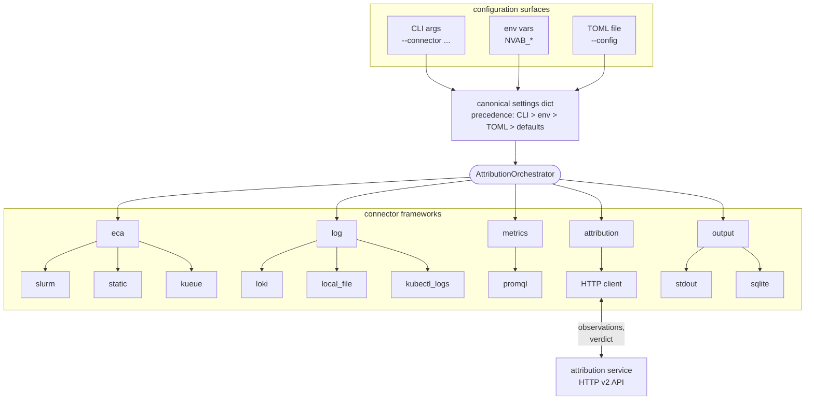

# Architecture

## Overview

NVIDIA Attribution is two components plus a set of connector frameworks the Blueprint exposes to operators.

| Component | Role | Language | External integration surface |
|---|---|---|---|
| Attribution Service (`nvidia-attribution-service`) | HTTP REST service. Owns the rules engine. Receives observations, returns one verdict per attributor handle. | Python `>=3.14.6,<3.15`, FastAPI / Uvicorn | HTTP API at /v2/... |
| Attribution Blueprint (attribution-blueprint) | Single-process reference orchestrator. Discovers workloads, collects observations, calls the Service, writes verdicts. | Python 3.11+ | CLI entry: nvidia-attribution-blueprint. Read-side dashboard: nvidia-attribution-blueprint-web. |

The Service does not query schedulers, read logs, or scrape metrics. The Blueprint does. The Service receives normalized observations over HTTP and returns a verdict. That separation is what lets operators run the Service centrally and the Blueprint at the edge of each cluster.

## End-to-end flow for one workload

1. **Discover.** The Blueprint's execution-context adapter (Slurm shells to `sacct`, Kueue shells to `kubectl`, Static hand-feeds one workload) returns one or more `ExecutionContext` objects.
2. **Collect.** For each context, every configured log and metric collector runs `collect(ctx)` and returns zero or more `Observation` objects. Each `Observation` carries a `Source` enum value (`applog`, `syslog`, `node_metrics`) and a body in one of the wire-format `Format` values.
3. **Open attributor.** `POST /v2/attributor` creates a per-context handle. Idempotent: on a 409 conflict the client deletes the stale attributor and retries once.
4. **Submit observations.** Each `Observation` goes via `POST /v2/attributor/{id}/observation`. Individual failures are logged and skipped.
5. **Get verdict.** `GET /v2/attributor/{id}/attribution` returns the raw verdict.
6. **Clean up.** `DELETE /v2/attributor/{id}` so re-runs don't collide.
7. **Enrich.** The Blueprint's `result.enrich_attribution_result()` maps the service verdict to `(terminal_state, sub_domain)` via `taxonomy.py`, and attaches a `ConnectorReport` per collector.
8. **Write.** Each configured output sink (`stdout`, `sqlite`) persists the enriched result.

## Connector frameworks

The Blueprint's configuration model is patterned on Open MPI's Modular Component Architecture (MCA). Frameworks group components by role. Each framework registers at import time.

| Framework | Components today | Shape | Sources |
|---|---|---|---|
| eca (execution context adapter) | slurm, kueue, static | component-selector | (none) |
| log | loki, local_file, kubectl_logs | per-source component-selector | applog, syslog |
| metrics | promql | per-source component-selector | node_metrics |
| output | stdout, sqlite | per-instance component-selector | (none) |
| attribution | (implicit HTTP client) | flat: service_url, timeout_seconds | (none) |
| workload | (no components) | flat: gpus_per_node, used to build service v2 node-to-ranks payload | (none) |

Three configuration surfaces feed one canonical settings tree: CLI flags (`--connector eca slurm ids "1,5,7"`), env vars (`NVAB_ECA_SLURM_IDS=...`), and TOML (`[eca.slurm]` with `ids = "1,5,7"`). Precedence: CLI > env > TOML > defaults.

## Output schema

The Service returns a raw verdict. The Blueprint enriches it with normalized fields and connector telemetry. Grounded against `src/attribution_blueprint/result.py` and `taxonomy.py`.

| Field | Type | Values |
|---|---|---|
| terminal_state | string | pass, fail, cancelled, expected_failure, unknown |
| sub_domain | string | none, hardware, system_software, application, ambiguous, unattributed, expected, artificial, unclassified, plus cancellation/incomplete variants |
| tenant_sre_action | string | Reserved field that is currently emitted as an empty string. |
| cloud_operator_sre_action | string | Reserved field that is currently emitted as an empty string. |
| connector_reports | list | List of {connector: str, source: str, status: "ok" or "error", reason: str, observation_count: int} |

`terminal_state` and `sub_domain` are mapped from the service verdict via `taxonomy.py`. The mapping is deterministic. Downstream consumers should branch on these normalized fields.

`connector_reports` is the collector coverage record for a run. A collector that raised mid-run reports `status: "error"` with a reason. A collector that returned zero observations reports `observation_count: 0`. Observation submission failures after collection are logged and skipped by the Blueprint, but they are not represented in `connector_reports`. Downstream consumers treating verdicts as evidence should inspect this list and the run logs.

## Data sources (V1)

| Source | What it carries | Connectors that emit it |
|---|---|---|
| applog | Application stdout, NCCL output, framework logs from PyTorch and NeMo, anything written by the workload itself | loki, local_file, kubectl_logs (pod stdout) |
| syslog | Kernel ring buffer, XID lines, dmesg, systemd, fabric manager | loki, local_file, kubectl_logs (with a node-agent DaemonSet) |
| node_metrics | DCGM counters, NVLink PLR, host-side fabric counters, anything PromQL can query | promql |

Source names are wire-format enum values the Service expects. Each log or metric connector instance produces exactly one `Source`. A backend serving multiple Sources is instantiated once per Source so failure isolation lives at the instance boundary.

## Auth

The Blueprint's `connectors/auth/` package provides two HTTP auth schemes shared by telemetry connectors (Loki, PromQL):

* **Token-based.** Bearer token in the `Authorization` header. Token issuance happens through whatever identity system the operator already runs.
* **mTLS.** Mutual TLS. Client and server certificates configured per connector instance.

The Blueprint attribution client calls the Attribution Service with `service_url`
and `timeout_seconds`; it does not attach bearer-token or mTLS credentials to
Service requests. If a deployment needs auth in front of the Service API,
terminate it outside the Service process, for example at an ingress, gateway, or
sidecar.

## Output backends (V1)

* **stdout.** Prints the enriched result as JSON. Used for one-shot CLI runs and for piping into other tools.
* **sqlite.** Persists the result into a local SQLite database. The schema lives in `blueprint/docs/output_schema.md` and carries three tables (`schema_version`, `execution_context`, `attribution_run`). The read-side `nvidia-attribution-blueprint-web` dashboard queries this database.

Multiple sinks can be configured per run. Per-sink failures are isolated. The architecture supports additional sinks (Elasticsearch, Kafka, downstream HTTP) via the same `OutputConnector` Protocol. None ship at V1.
