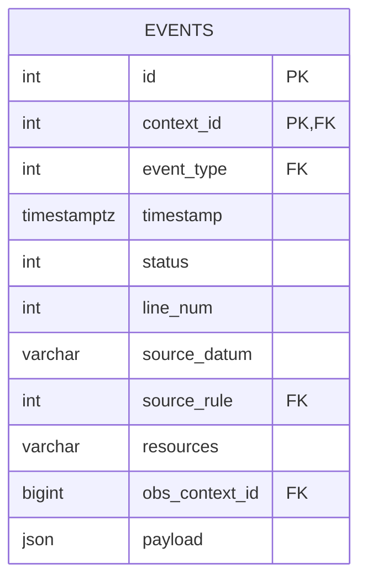
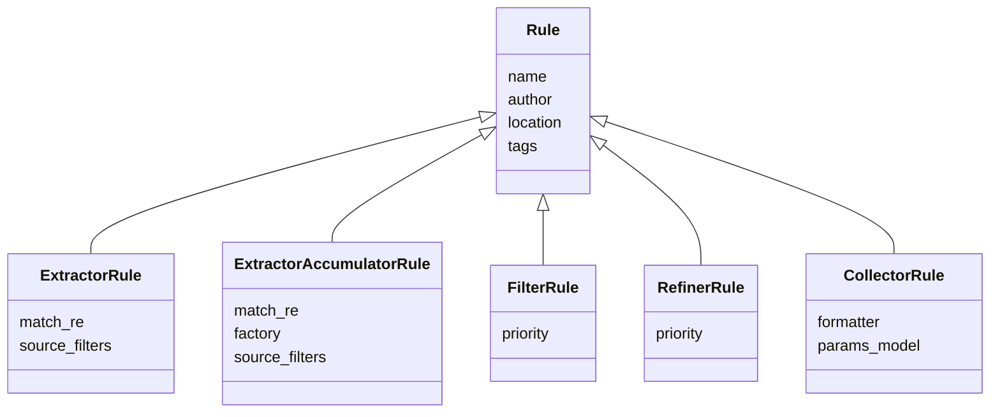
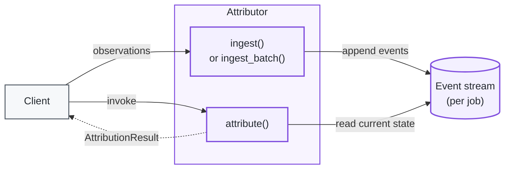
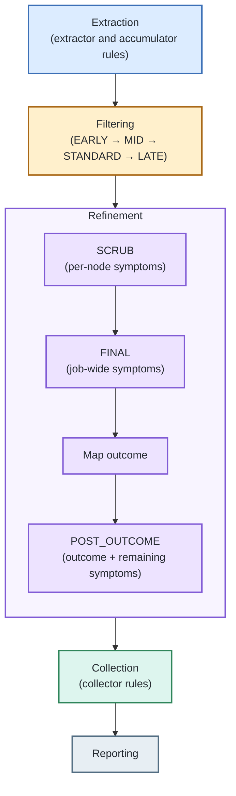

How Attribution Works
=====================

There are many parts involved in a system that does automated job attribution: scheduler interfaces, telemetry and log ingestion, rule processing, reporting, and aggregation.

This repository-level document describes the rule-processing model at the center of NVIDIA Attribution. The Blueprint supplies normalized observations to the Service, the Service manages the attribution lifecycle, and the attribution library analyzes that evidence and produces a result.

For a concrete end-to-end example, see the [interactive attribution process walkthrough](https://dsx-ai-factory.github.io/attribution/walkthroughs/attribution-process/).

- [Elements of Attribution](#elements-of-attribution): symptoms, outcomes, sources
- [Attribution Process Overview](#attribution-process-overview): state, events, rules, rule engine/loader
- [Ingest-Attribution Cycle](#ingest-attribution-cycle): calling `ingest()`/`attribute()` in any order
- [Detailed Attribution Phases](#detailed-attribution-phases): extraction through reporting
- [Rule Types](#rule-types): extractor, filter, refiner, collector
- [Appendices](#appendices): initialization order

## Elements of Attribution

This covers the core concepts of attribution.

### Symptoms

The fundamental element in attribution is the symptom. This is a piece of concrete evidence that the attribution system recognizes. One can associate them with human-readable items like "ECC Error" or "IB Error-12", but they also carry other semantic information that is used in attribution. Symptoms are carried by [bad node and interesting node events](#bad-nodes) and are ultimately consumed by [refiner rules](#refiner) and mapped to an outcome in [Phase 3: Refinement](#phase-3-refinement).

### Outcomes

An outcome is a category that helps identify the type of failure that occurred. Outcomes are computed from the remaining symptoms at the end of [Phase 3: Refinement](#phase-3-refinement), after the `FINAL` sub-phase and before `POST_OUTCOME`.

N.B. Outcomes will become compound in the future, allowing a set of semantically orthogonal values to be combined.

### Sources

Primary data for attribution comes from logs, metrics, and telemetry. It is important to track this information throughout the attribution process, so information about the provenance of a given internal representation (symptom, outcome, event, etc) is carried with it. A source will often say from which rule the item originated, as well as the line number, time, and type of data that produced it. See [Events](#events) for how source information is represented on an event record.

`JobInfoBuilder` accepts two optional inputs for a record that represents part of an allocation, such as an array task's participation in an NVRx cycle. `allocation_failure` is a `SchedulerFailure`: the allocation's ID, state, failed node and source. Its time is when the scheduler reported the failure, not when the failure began. `execution_cancellation` is an `ExecutionCancellation` that the caller has established for this record: the record ID, who cancelled it, and a timezone-aware source time. A mismatched record ID or a missing identity or timestamp is rejected.

A supplied cancellation provides the record's cancellation symptom, regardless of the record's raw scheduler state. Independent faults still take precedence. `allocation_failure` changes attribution only together with a cancellation. When the record's state is `NODE_FAIL` and the allocation's failed node is not among the record's nodes, the inherited node failure is not attributed to the record, unless the record's own `failed_node` names a different node that is among its nodes. Omitting both inputs keeps existing behavior.

## Attribution Process Overview

### State management

Attribution stores the bulk of its state in a relational database. The current implementation uses an in-memory database with lookup tables and a shared `events` table. Code accesses the rows for one job through an `EventStream`; throughout this document, **event stream** refers to that per-job interface and **`events` table** refers specifically to its database storage.

`EventManager.close()` flushes buffered events before releasing its connection
and private spill files. Use `close(flush=False)` when discarding the data, as
the service does on retirement. Destructor cleanup also discards buffers;
call `close()` explicitly when flushing is required.

The `events` table is the only table that grows with job data:

<div align="center">



</div>

`context_id`, `event_type`, and `source_rule` are foreign keys into `contexts`, `event_types`, and `rules` respectively: small lookup tables (string name to integer ID) that are shared/preloaded from the rule engine, so events store IDs rather than repeating strings. `obs_context_id` points at `observation_contexts`, which records the time range, source, and format of the observation batch an event came from, itself referencing `obs_sources` and `obs_formats`. `events` is the only one of these tables that grows per-job.

### Events

The main objects manipulated during attributions are semi-structured records called "events"; these include source information, type information, resource association, and an unstructured "payload" that is specific to each type. 

For example, the `NVRXInjectedException` extractor rule (shown in full below) would produce an event roughly like this when it matches a line of applog:

```json
{
  "event_type": "Attribution.node.bad",
  "timestamp": "2026-06-01T03:14:02Z",
  "line_num": 118,
  "source_datum": "...InjectedException: nvidia_resiliency_ext.shared_utils.inject_fault.InjectedException...",
  "source_rule": "NVRXInjectedException",
  "resources": "node0042",
  "payload": { "node": "node0042", "symptom": "NVRx synthetic fault injection" }
}
```

A rule matching against node-metric telemetry instead of applog text might produce an "interesting node" event, whose only structural difference is the `event_type` and (typically) a less severe `symptom`:

```json
{
  "event_type": "Attribution.node.interesting",
  "timestamp": "2026-06-01T03:15:47Z",
  "source_rule": "node-metric-roce-adp-retrans",
  "resources": "node0017",
  "payload": { "node": "node0017", "symptom": "performance_roce_adp_retrans_high" }
}
```

There is no separate "bad node event" or "interesting node event" class; both are plain events whose `event_type` is one of a small set of well-known type names (e.g. `Attribution.node.bad`, `Attribution.node.interesting`, and peer-scoped variants like `Attribution.node.bad_peers`), which downstream code branches on when materializing per-node attributions.

#### Bad nodes

Many events indicate an issue that is local to a node; a so-called "bad node event". These carry a symptom and associated node and are passed further down the pipeline to be verified and manipulated. 

#### Interesting nodes

Still other events are used to indicate that an anomaly, but not necessarily a fatal one, occurred. These "interesting node" events are used for development of further rules or debugging.

### Rules 

Attribution is essentially the structured application of a series of rules. Rules have unique names and some metadata that indicate their type and provenance. The rule loader deserializes and initializes rule objects from storage, then passes them to the rule engine for execution.

<div align="center">



</div>

Every rule, regardless of type, carries a unique `name`, an `author`, and a `location` (source file and line it was defined at, for provenance/debugging). Filter and refiner rules additionally carry a `priority` that places them into the strata described in [Phase 2: Filtering](#phase-2-filtering) and [Phase 3: Refinement](#phase-3-refinement). See [Rule Types](#rule-types) below for the full detail of each rule type.

### Rule Engine

As mentioned above, the rule engine accepts initialized rules from the rule loader and organizes them for execution. Attribution runs in distinct phases, as described in [Detailed Attribution Phases](#detailed-attribution-phases), and the rule engine marshals the proper rules to be executed at the correct time. It also prepares environments and contexts for rules to be applied properly, and arranges the interface with the rule & event database (see [State management](#state-management)). 

### Rule Loader

The rule loader is responsible for  preparing rules for execution. For 'plugin'-type rules that appear as code, it is in charge of performing imports in proper sequence. For declarative rules, it is responsible for parsing and building the rule objects from source files. This includes verifying that rule dependencies exist and are compliant. There is also a global consistency check to enforce that rules have unique names. 

## Ingest-Attribution Cycle

While we typically think of attribution as a monolithic entity, it is sometimes useful to perform it incrementally; this reflects a natural pattern in production environments where some signals from a job may become available more quickly than others. It can be desirable to obtain a preliminary attribution based on whatever information is available initially, and to refine that as slower signals arrive.

<div align="center">



</div>

Either call, in any order, any number of times: `ingest()`/`ingest_batch()` only extracts events (write-only, as noted above) and adds them to the stream; `attribute()` runs filtering and refinement over whatever has been ingested so far and produces a result, without consuming or requiring anything further to be ingested first.

For this reason, the entire attribution process has two independent, repeatable components: ingestion, where observations are fed to the system and processed, and attribution, where attribution is performed using whatever observations have been ingested thus for. These two operations may be performed repeatedly, in any combination of orders.

Naturally, attribution prior to any ingestion will have no useful information, and it is similarly redundant to request repeated attributions without ingestion between them. Finally, ingestion without subsequent attribution leaves that data unused. 

## Detailed Attribution Phases

There are distinct, ordered phases to the attribution process. Each of these deals with a different type of data and uses a different type of rule to effect action in the system. 

<div align="center">



</div>

### Phase 1: Extraction

Most observations are at least partially unstructured; raw application logs may just be plain text, lacking timestamps or clear node/rank associations. Some data may have a clear timestamp and node, but a plaintext body. A critical part of attribution is to take unstructured data and identify relevant patterns; in effect, to produce structured records (i.e., events).

The first phase is extraction, where extractor and extractor-accumulator rules are run. These tend to rely on various forms of text matching to identify and extract data that may be useful for attribution in the form of events. 

Critically, the extractor phase treats the event stream as write-only; this is to ensure there is no coupling or dependency between extractor rules.

The extractor phase lines up closely with the 'ingestion' component in the [Ingest-Attribution Cycle](#ingest-attribution-cycle); while it is not normative that observations are eagerly extracted into events, this is the natural approach. See [Extraction](#extraction) under Rule Types for the varieties of extractor rule.

### Phase 2: Filtering

Filters are run next, after extractor rules. Filter rules explicitly can read and write the event stream, and their role is to handle inter-event interactions. The most common example of this is when a [bad node event](#bad-nodes) is 'demoted' to an [interesting node](#interesting-nodes) because of some other event that occurred. Filter rules each have a priority, which are effectively used to produce discrete strata, and are applied in priority order. See [Filter](#filter) under Rule Types for the priority strata and an example rule.

### Phase 3: Refinement

The refinement stage looks at all of the symptoms that have been collected in bad node events and considers them as a whole. Like the filtering phase, there are priorities that act as de-facto sub-phases that control the order that refiner rules are run. 

First, the `SCRUB` priority looks at each node individually and considers the symptoms that have manifested for that node. The rules applied here will demote or remove subordinate or noisy symptoms. 

After `SCRUB`, all remaining symptoms across all nodes are aggregated into a set and the `FINAL` rules are run demote/remove rules based on known cascading relationships. When this sub-phase finishes, per-node symptoms (from bad node events or others) are cleaned up to reflect discarded/demoted symptoms. 

After `FINAL`, the remaining symptoms are mapped to an outcome, which is used in the final report. 

There is a further sub-phase of `POST_OUTCOME` rules that take the computed outcome as well as the remaining symptoms to inform the final result. See [Refiner](#refiner) under Rule Types for the priority strata and an example rule.

### Phase 4: Collections

Collector rules do not strictly affect the attribution result; instead, they exist to help surface useful information that may have been collected into the event stream during the attribution process. This may be relevant job parameters or component versions found during the attribution process. See [Collector](#collector) under Rule Types for more detail.

For NCCL `Got completion from peer` errors, the `bad_pairs` collector preserves
the explicit source hostname even when it is outside the workload's node list.
When no hostname is printed, a mapped local GID can supply it. If neither
provides a hostname, a verified producer-declared node or an explicit leading
rank resolved within the supplied workload can supply the source, even when a
local GID is present but unmapped. The internal source retains `declared_node`
to distinguish producer metadata from parser fallbacks. An implicit rank-zero
default is not source evidence. When no hostname is known, `src_node` stays
null and an available IP remains in `src_ip`.

If the logged hostname and the hostname mapped from its local GID disagree,
`src_node` keeps the logged hostname and `src_gid_node` exposes the mapped name.
When reverse-direction reports are combined, the corresponding information
can appear as `dst_gid_node`. These extra fields are omitted when the names
agree or no GID hostname is known. Conflicting IPs, interfaces, or GID hostnames
remain separate pairs. These fields describe network evidence; they do not
change workload membership or establish that either node is faulty.

### Phase 5: Reporting

There are no rules specific to the reporting stage; instead, remaining bad nodes are collected, and the outcome, plus the root cause symptom and any collector results are formatted and returned in the attribution result. 

## Rule Types

### Extraction

As mentioned above, extractor rules are used to prepare unstructured or semi-structured input data into the structured [event stream](#events) used by later phases. There are a great number of extractor rules, reflecting the breadth of the space of unstructured observations. See [Phase 1: Extraction](#phase-1-extraction) for where these rules run in the overall process.

Extractors are fundamentally string-oriented; they generally have a regular expression that characterizes the basic form they match on, and some logic shape the event or events they produce.  For each observation line ingested, rules engine determines which extractor rule(s) apply to it and executes them, adding the resulting events to the event stream. Basic job information can be read by extractor rules, but recall that the event stream is write-only during this phase.

Extractor rules are almost exclusively expressed in declarative form (TOML), with some support functions in Python plugins. 

Basic extractor rules come in three varieties:

#### Individual

These are simply discrete extractor rules, expressing some unique pattern of interest. They stand in contrast to catalog and family-based extractor rules. 

An individual extractor rule, simplified from `bundled_rules/nvrx_leaf_rules.toml`:

```toml
[[extractor]]
name     = "NVRXInjectedException"
match_re = 'nvidia_resiliency_ext\.shared_utils\.inject_fault\.InjectedException'
emit     = { type = "bad_node", symptom = "NVRx synthetic fault injection" }
```

`match_re` is the pattern applied to observation lines; when it matches, `emit` describes the event the rule produces, here a bad-node event carrying the given symptom.

#### Family 

Extractor family rules are essentially a shorthand convenience for a group of extractor rules that share some common structure. They are expanded from a template upon load time and manifested as distinct rules. 

#### Catalog 

Extractor catalog rules exist as a way to conveniently include a catalog lookup as a compound extractor rule. There are  expanded at load time and stand as a one-to-many lookup rule.

#### Extractor-Accumulator

Extractor-accumulator rules are a special case that stand distinct from the usual extractor rule. They are run during the extractor phase, but they are state machines that can consider multiple lines at once. Extractor-accumulator rules have an initial trigger pattern, and then are fed subsequent lines from the same observation until they opt out. When finalized, they may produce some events. 

Extractor-accumulator rules are very niche and complex, and are only supported as Python plugins. 

Extractor rules are so numerous, and are applied to so many incoming lines of observations, that we use a special acceleration structure to speed up the matching process. It is possible for a set of rules to confound some of the heuristics of this acceleration structure, generally by having overlapping or overly-broad regular expressions for matching. Care should be taken that the rule corpus not drift into an inefficient or inter-dependent state. 

### Filter

As mentioned above, filter rules handle inter-event interactions. Filter rules most commonly demote events based on other events that have occurred. Some events produced during extraction actively indicate what types of demotion they may be eligible for, while others are demoted by markers that a given filter rule might identify---for example, a certain type of symptom. See [Phase 2: Filtering](#phase-2-filtering) for where these rules run in the overall process.

To control the order filter rules are executed in, their definitions are accompanied by a priority, generally managed in discrete strata: `EARLY`, `MID`, `STANDARD`, `LATE`. 

Filters are exclusively written as Python plugins. 

A filter rule, simplified from `bundled_rules/filter_rules.py`:

```python
@filter_def(name="DemoteInsufficientPermissions", author="NVIDIA Attribution team", priority=FilterPriority.LATE)
def demote_insufficient_permissions(context: FilterContext):
    """Demote insufficient-permissions telemetry from bad to interesting."""
    symptom = "NV_ERR_INSUFFICIENT_PERMISSIONS"
    _demote_bad_by_symptom(context.event_stream, frozenset((symptom,)), "DemoteInsufficientPermissions")
```

The rule reads and writes the event stream directly via `context.event_stream`, demoting any bad-node event carrying this symptom to an interesting-node event.

### Refiner

Refiner rules are focused on manipulating sets of [symptoms](#symptoms) to capture known cascading and other interactions. The intention is to reduce the number of symptoms present during the final stages of attribution for a clearer signal. See [Phase 3: Refinement](#phase-3-refinement) for where these rules run in the overall process.

Like filter rules, refiner rules have a priority, also managed in discrete strata: `SCRUB`, `FINAL`, `POST_OUTCOME`. Unlike filter rules, the refiner priorities have distinct boundaries with different semantics.

Rules that are `SCRUB` or later (but before `FINAL`) operate on node-centric sets of symptoms. Rules that occur in `FINAL` or after, up to `POST_OUTCOME` operate on job-wide symptoms. Before `POST_OUTCOME` begins, these changes to the global symptom set are back-propagated to the node symptom representations (generally, bad-node events.) The last sub-phase, from `POST_OUTCOME` onward, operates on the global symptom set and chosen outcome. 

Refiner rules are exclusively written as Python plugins. 

A refiner rule at `FINAL` priority (job-wide symptoms), simplified from `bundled_rules/refiner_rules.py`:

```python
@refiner_def(name="Xid171Cascade", author="NVIDIA Attribution team", priority=_priority("Xid171Cascade"))
def xid_171_cascade(context: RefinerContext):
    """XID-171 (UNCORRECTABLE_DRAM_ERROR) -> discard less specific cascaded symptoms."""
    symptoms = context.symptoms
    if symptoms is None:
        return
    if any(sym.startswith("XID-171") for sym in symptoms.symptoms()):
        _discard_xid_cascade_from_symptoms_and_nodes(
            symptoms,
            context.my_bad_nodes,
            ["XID-48-", "XID-63-", "XID-94-", "cudaErrorContained"],
        )
```

This rule operates on `context.symptoms`, the aggregated job-wide symptom set, rather than a single node's events, characteristic of `FINAL`-priority refiners, as opposed to `SCRUB`-priority refiners which see one node's symptoms at a time.

### Collector

Collector rules read the event stream and return dictionaries, generally with keys that identify semantically useful fields and bodies composed of the digested events. They are the simplest form of rule, and are run at the end of attribution. They are solely declared as Python plugins. See [Phase 4: Collections](#phase-4-collections) for where these rules run in the overall process.


## Outcome mapping 

Near the end of the attribution process (specifically, in the refiner phase, after the `FINAL` sub-phase but before `POST_OUTCOME`), the aggregate set of symptoms is collectively analyzed and the outcome for the attribution determined. 

Outcome is intended to convey a category (or multiple categories) for the attribution. Each symptom has an outcome associated with it as well as a ranking. The highest-priority remaining symptom is chosen as the root cause, and the outcome selected from that.

## Appendices

### Initialization order

1. Idempotency check: if already initialized and force=True isn't passed, `setup_rules()` returns immediately.
2. Resolve rule paths: defaults to the package's bundled `bundled_rules/` directory unless explicit paths are given. 
3. Set global config: marks attribution_lib.initialized = True, stores the node-domain resolver, and optionally configures node-name-mapping / ignored-hostname-prefix settings. 
4. `RuleLoader.load_all()` does the actual loading pass:
   - Registers the four built-in rule types (collector, extractor, filter, refiner) via their `@rule_type` decorators.
   - Globs the rules directory for top-level `*.py` and `*.toml` files only (non-recursive, so `bundled_rules/common/*.py` is never loaded directly: only imported by the top-level rule modules), sorted, skipping `*.test.toml`.
   - Each `.py` file is exec'd fresh (module globals bound to the loader so its decorators register rules/symptoms); each `.toml` file goes through the declarative loader instead. Duplicate/conflicting registrations raise immediately.
   - `loader.build()` freezes everything into an immutable `RuleEngine`.
5. Store the engine as `attribution_lib._rules_engine`.
6. Compile the symptom registry: builds the runtime `GeneratedSymptomRegistry` (registered symptoms, outcome rules, metadata, aliases, docs) once from the loaded declarations, stored as `attribution_lib._symptom_registry`. 

### Checkpointing

The [Ingest-Attribution Cycle](#ingest-attribution-cycle) process is made possible by careful handling of the event table during the attribution process. Since ingestion is append-only, and attribution has stages that can cause destructive modification to the event table, we create a snapshot of the event table before beginning attribution, and we restore this checkpoint before another ingestion begins. This checkpoint can be done in-memory, as part of a database restore point, or on disk. 
